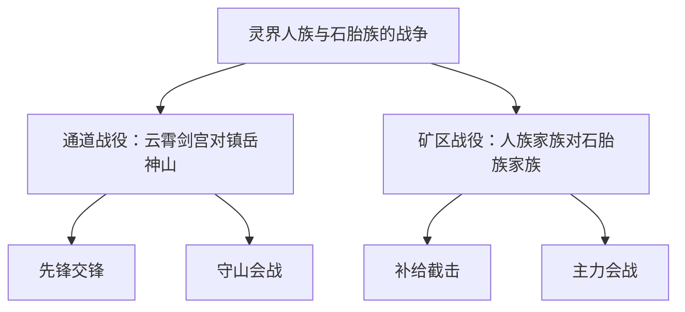

# 种族外交与三层战争系统策划案 V0.1

编写日期：2026-10-15。代码基线：本体 v2.13.6、存档结构 10。

状态：分阶段开发设计稿，首期同界实现纳入 v2.14.0，具体能力、未完成项及发行验收见[实现记录](strategic-war-implementation.md)。本稿包含尚未实装的完整目标，不表示所有阶段已经上线。用户确认方向与建议参数分别列出，以经过验收的阶段为准。

## 1. 已确认目标与首期范围

### 1.1 用户确认的核心规则

1. 种族负责外交与整体战争，不再直接抽取同族修士组成独立参战方。
2. 战争的实际执行组织是宗门或家族；两个种族的战争由其支持组织之间的多场战役组成。
3. 明确区分战争、战役、战斗。现有宗门对宗门的战局归入战役层，保留多次实际交锋。
4. 组织支持哪个种族，应影响动员、阵营、援助、战争责任与战后利益。
5. 战争政治决策、整体军事统筹、组织战役指挥分别授权；玩家按实际资格参与，NPC 也能担任决策者与统帅。
6. 复用权威人物、战斗、府库、军需、地图、时间与跨界入口，特别控制百年行动耗时及验收内存。

### 1.2 建议的首个可玩交付

先完成灵界与真魔界的同界种族战争，形成完整的宣战、组织承诺、多个战役、总战果、总和约与撤军闭环。本体提供基本外交与战争，内政 DLC 提供政治性格和更丰富的决议；关闭 DLC 仍有可工作的基本规则。

妖界、幻冥界、幽冥界按实际加载的种族内容分别适配。万灵氏族、野生种群和王庭继续保留各自含义，不自动成为军事组织。未实例化的动态宗门／家族按第 17 节先完成合法落址、有限资材交接与正常成员生成，才能签署执行承诺；单纯名字不能直接充当军队、府库和战役。

首期不开放任意跨界进攻，不将岚疆固定案例泛化成全界战争，不新增普通人口逐人模拟、种族公有国库、无限征兵、全地图占领或玩家远程瞬时接管。跨界阶段在同界闭环后独立交付。

## 2. 当前实现与改造依据

| 当前入口 | 已有能力 | 本次架构要求 |
| --- | --- | --- |
| [族群配置](../content/races.json) | 种族、所在世界、初始关系、支持宗门预设 | 配置只定义可能存在的内容；实际参战须解析原组织。关系必须有明确世界归属。 |
| [族议与宗门外交](../cultivation_life/engine/actions/factions.py) | 基础族议、内政决议转发、关系变更 | 族议宣战创建上层战争；不能继续创建直接抽取同族人物的战局。基础族议的人族限定需改为本界合法政治主体。 |
| [外交时钟与 AI](../cultivation_life/engine/world/factions.py) | 按行动单位更新外交，随机结盟、宣战、依附 | 新战争使用明确诉求与组织可执行性评估；旧独立宗门战役保留原时钟。 |
| [战局状态](../cultivation_life/system/war/state.py)、[宣战与盟友](../cultivation_life/system/war/diplomacy.py) | `game.wars`、阵营、名册、指挥权、盟友 | 复用为战役执行器。新托管战役的参与者只能是实际组织，关联上层战争与目标。 |
| [战斗推进](../cultivation_life/system/war/lifecycle.py)、[战斗动作](../cultivation_life/system/war/actions.py) | 先锋、主力会战、士气、厌战、伤亡、玩家参战 | 每个战役仅有一个调度者；不能同时被旧单位流程与新日历流程推进。 |
| [军需](../cultivation_life/system/war/logistics.py)、[需求](../cultivation_life/system/war/requirements.py) | 原组织分摊、真实库存与付款、有效部署人数 | 按承诺的组织与人员筹集；禁止沿种族 ID 征用全族所有组织。 |
| [战役和约](../cultivation_life/system/war/peace.py) | 战果条款、赔款、附庸、产业与地方权益 | 子战役只能处分有授权的组织权益；总和约由上层政治决策，逐条复用实际结算服务。 |
| [读档世界准备](../cultivation_life/engine/persistence/world.py) | 同步玩家政治归属；`_ensure_wars` 可根据旧关系补建战局 | 必须阻断新旧族战重复生成；查询、兼容接续和正式生成分别处理。 |
| [人物占用](../cultivation_life/person_assignments.py) | 诸天部署、访学、调查、货运与迁居占用 | 扩展统一只读占用解析，涵盖所有普通战役；不能为每个战役复制人物。 |
| [岚疆军事案例](../cultivation_life/system/heavens/campaign.py) | 原组织批准、真实成员、有限路线、预算、建设、运输和撤离 | 提取可复用的授权与部署契约；固定阵营、资产和通道不是通用生成器。 |
| [万灵氏族](../cultivation_life/system/monster_civilizations/core.py) | 文化氏族、族长、份额、生态与王庭 | 保持独立；氏族结盟不直接等于宗门参战，生态数量不兑换成修士。 |

特别注意：当前 `allegiance_race` 已用于部分政治归属和军需归集，并非完全无效。本案要补齐的是“公开支持—正式参战承诺—具体战役部署—战后责任”的完整关系，不能只把预设卡片改成可点击按钮。

## 3. 三层结构与基本体验



图中名称仅说明结构。正式案例必须解析本次存档中的真实组织、人物与实际地图地点，不能因文案引用而新建对象。

| 层级 | 核心对象 | 权威结果 | 不负责的事项 |
| --- | --- | --- | --- |
| 战争 `StrategicWar` | 族群政治主体、参战组织、总体目标、统帅、外交与总和约 | 目标控制、整体态势、阵营履约、战争胜败 | 不创建种族军队，不重复结算战斗伤亡或军需 |
| 战役 `Campaign` | 原 `game.wars` 战局、真实组织、战场、名册、后勤 | 任务达成、撤退、组织投降、战役结束 | 不替其他组织处分资产，不单独结束整个种族战争 |
| 战斗 `Engagement` | 实际出战人物与原战斗服务 | HP/MP、领域资源、伤势、伤亡、拘禁、局部士气 | 不另造战争库存，不因一次胜利自动占领全宗或全界 |

独立宗门或家族冲突仍是一场独立战役，允许没有上层战争。多个独立冲突不能因种族相同就自动合并。

### 3.1 一局完整流程

1. 两个本界族群因边境、据点、盟约违约等实际利益产生外交议案，或玩家主动提出合法议案。
2. 宣战方族议确认目标、可承担的责任及授权范围。对方收到有来源的宣战消息；防御组织可直接办理本地守备，不以同意被宣战为前提。
3. 支持组织分别承诺出兵、援助或中立，确认额度和退出条件。只有具备实际执行能力的组织进入军事计划。
4. 任命统帅；在有限数量的实际目标中分配战役，由组织派出原人物、实付军需并按道路部署。
5. 多场战役先后或并行发生。玩家可参与一场战斗、指挥本组织战役，或在受任统帅后协调多场战役。
6. 战斗与战役结果逐级上报；战争态势变化引发增援、轮换、拒绝继续出资、提出和谈等选择。
7. 总和约经相应批准后停止敌对，处理各组织条款、撤军、退款、俘虏和未交付物资；全部必要义务收束后战争归档。

## 4. 族群身份、组织支持与参战承诺

### 4.1 四种身份分别记录

- 人物血统／种族：读取原人物与族裔定义，不随组织立场改写。
- 人物政治归属：复用现有政治归属规则，不直接代表本人已经投入某场战役。
- 组织公开支持：`SectState.allegiance_race` 为组织支持种族的唯一主字段，按组织实际世界解释。
- 战争参战承诺：属于特定战争的合同，引用实际组织、签署权限、支持主体和承诺额度；不由玩家当前世界反推。

政治主体使用 `(world, race_id)`，例如 `spirit:human`。不能让灵界的一次宣战直接改变真魔界同族的关系。跨界战争须显式列出各端主体和路线；独立空间不创建普通族议或外界参战组织。

### 4.2 组织承诺的三种状态

| 承诺 | 权益与职责 | 明确限制 |
| --- | --- | --- |
| 正式参战 | 接受有限动员，承担战役，可申请增援和参与战后分配 | 只动员批准的人员与经费；其本部是否受攻击取决于战役目标与合法路线 |
| 仅援助 | 交付约定现金、物资或运输服务，保留援助记录 | 不自动出兵、不自动授予其人物战争指挥权 |
| 中立／未承诺 | 保留组织正常经营与成员身份 | 不因同族自动征用资产；已有条约义务被拒绝时承担明确信誉与外交后果 |

支持关系决定优先动员对象、援助义务和政治评价；实际承诺决定可用兵财。敌方支持列表本身不是立即袭击任何成员的许可，不以同族身份将无关 NPC 直接列入战斗名册。

改变支持须经过本组织原决策入口。战时转向不能清除已发生的伤亡、付款、赔款或承诺；须先撤回本组织部署、处理旧合同，再改变后续立场。首期禁止同一组织同时向同场战争双方正式参战。

玩家同时控制的宗门与家族若分属敌阵，须明确本人本场立场；个人不能同时进入双方名册，也不能凭另一身份查看敌方秘密或下令。另一组织由合法 NPC 代理，没有代理时只维持既有防御与安全撤回，不制造替代人物。

### 4.3 家族与预设内容边界

家族必须是存档中实际存在、能被权威组织解析器找到的对象，包括 `game.family` 及当前结构支持的既有家族实体。首期不补造全世界家族；原架构不支持的家族形态不能只在 UI 中伪装为有效参战者。

预设支持宗门仍可供百科展示，但没有实际实体的预设不进入投票、动员、军费或战果统计。动态名录可进入只读意向筛选，正式互动前须完成第 17 节的实例化，不能跳过实际资源与人物检查。未知组织或已灭亡组织只保留历史引用。

## 5. 决策归属与玩家权限

### 5.1 政治决策、统筹与执行

| 决定 | 批准者 | 执行者 | 玩家取得权限的条件 |
| --- | --- | --- | --- |
| 宣战、加入族群联盟、总体目标、总和约 | 本界族议；双边协议还须对方批准 | 政治代表与战争服务 | 本界合法议席，不由持有宗门自动取得 |
| 本组织出兵、援助、承诺额度、退出 | 原宗门／家族决策主体 | 组织负责人或授权代表 | 原组织控制／议事资格 |
| 统帅任免、重大目标调整、追加动员请求 | 战时参战组织联席会议 | 当届统帅 | 被正式任命并在授权有效期内 |
| 有效承诺内的目标分配与增援协调 | 统帅 | 已批准执行的组织 | 不得超越人员、经费、地域与时限 |
| 战役动员、进退、补给与局部和约 | 战役负责人；超合同处置回本组织批准 | 原战役执行器 | 本组织权限或明确战役委任 |
| 玩家亲自参战 | 玩家本人 | 原详细战斗入口 | 本人实际在场、属于合法参战方且当前状态允许 |

拥有种族议席不等于控制全族军队；拥有宗门权力不等于能结束整体战争。统帅本人不是每场战役的自动参战修士。

### 5.2 基础议事与 DLC 增强

基础族议沿用当前合格人物的一人一票，门槛按本界修为坐标配置，不把所有世界统一写死为“大乘”。候选须存活、同界、可触及、未被拘禁且无冲突任务；具体资格复用原组织权限和人物访问服务。

战时军事联席会议由每个正式参战组织授权一位真实代表；同一人物兼任多组织代表仍只有一票。组织不能靠承诺一个任意大数字取得更多票。代表资格、替换和当前可履职状态须可核验；没有代表的组织保留合同与资产权，但不凭空补票。

内政 DLC 启用时，复用性格、治理倾向和实际关系计算投票理由；关闭时使用基础关系、实力、目标利益、损耗与承诺负担。军事联席会议和族议是两个不同范围的议事机制，不能把组织代表票重复加进个人族议。

### 5.3 统帅与代理

统帅从实际合格、接受任职的人物中推举，比较战功、修为、组织支持与可履职状态，由军事联席会议过半有效票确认。平票保留原任；无原任则按预先声明的稳定排序产生临时协调者，仅能维持已批准防御与撤军，不能扩大战争目标。

建议委任期限为一百个实际年或战争结束，以先到者为准；这是待校准参数。死亡、被俘、失去组织授权或无法履职时先启动已登记副手，再办理正式继任。不能每年重选、复制旧统帅或自动把最强者任命为全族独裁者。

玩家可以接受、拒绝、辞任或委托已有合格代理。继任保留战局和原资产，旧统帅不能用过期页面继续下令。跨界后保留履历与委任记录，首期不因此开放异界即时发令，原受托组织继续履约。

### 5.4 手动指挥与后台世界

2026-10-15 用户追加的调度边界：统帅只能调遣未在任何战役中的闲置宗门／家族；行军、交战、待结算、撤军期间整宗占用，不允许抽取留守修士另赴战场。多宗增援加入同一原战役，两边联军仍按原组织保存名册、经费与伤亡；本轮不开放在战宗门转进。具体已实现范围见[首期实现与闲置预备队](strategic-war-implementation.md)。

现有独立战役和 `auto_advance_player_wars` 的旧语义保留。新托管战役中，手动指挥保留玩家主动进攻与策略选择；敌军推进、最低守备、真实驻军费用不因玩家没有打开窗口而冻结。未授权自动进攻时不能把玩家本人编入队伍。

战争关注允许选择重大变故暂停、仅留战报或委托处理。需要玩家确认的进攻未批准则不启动；不能把整个世界卡在无限等待批准中。本人遭遇仍通过原事件与中断流程处理，不能用汇总报告替代真实必经战斗。

## 6. 外交与战争目标

### 6.1 外交动作

首期提供交涉、结盟、断盟、宣战、提出总体停战和提交总和约。结盟与和平需要双方有权主体认可；宣战和断盟为单方决定，承担关系、信誉和合同后果。

宣战议案至少声明目标、敌对政治主体、计划动员组织和实际可达地区。NPC 主动宣战沿用至少三场会战储备的偏好，并检查可用人员、合法目标和路线；防御不会因为无钱而失去存在资格。玩家可在界面说明风险后发起弱势战争，但不能绕过目标存在性、封印、路线、资产和权限校验。

AI 的候选动机来自实际地区争端、盟友求援、毁约或有据可查的冲突。每次只评估有限候选；没有利益、执行组织或有效路线时不制造战役。随机性用于合法方案中的选择与投票，不用一次随机数把友好双方直接改成交战又立刻和好。

### 6.2 首期战争目标

| 目标 | 战役执行条件 | 结果与和约边界 |
| --- | --- | --- |
| 保卫／解除指定地区压力 | 本地实际组织、有效战场与可用守备 | 解除该地区军事威胁，不增加所有权或资源 |
| 捣毁指定组织据点 | 该据点真实存在、交战合法且可到达 | 复用原捣毁条款，不多发一份奖励 |
| 迫使指定组织撤除地区影响 | 原影响存在且允许依法处分 | 复用原影响移除及必要迁址，不搬运旧库存或阵材 |
| 迫使指定参战组织赔款 | 有具体付款义务人、收款者和额度 | 仅转移实际可支付资金，付不起须重新谈判或明确接受部分支付 |

通道安全和物资护送可先作为战役任务，完成后只改变对应原路线或运单状态；没有通用控制服务的地图不得凭战争分数新增“占领所有权”。种族不能被一次和约删除、合并或改写血统。组织解散、吞并等高影响条款首期不纳入总体和约，独立旧战役保留原合法规则。

战役获胜不必立即转移产权；其直接成果可以是“取得要求撤除影响的谈判资格”。实际产权、据点或迁址在明确授权的条款执行时改变。总体目标与该改变分别显示，避免用战报文字冒充已执行结果。

## 7. 战役编排、战斗与总战果

### 7.1 创建和推进战役

每场战役绑定一个具体地区与一个有限任务，列明攻守组织及其承诺。一个战役可有组织盟友，但单个组织必须分别批准加入；种族盟约不能自动触发旧 `_call_war_allies` 无预算拉人。

战前按原人物身份去重，检查存活、自由、实际世界／实例／地点、研究与行军占用、其他战役部署。组织可以分出不同真实成员承担不同战役，同一人不得同时出现在两个有效部署中。家族和宗门引用同一人时也不能重复动员。

首期在实际发生的同界地点执行。现有抽象战役缺少通用行军闭环，不能仅因道路存在就视为已经抵达：部署适配器必须保存道路、已耗工时、到达与撤回阶段，接入原年度人物流程。到达前只登记出征和费用，不贡献现场战力；守山阵仅按原阵实际地址生效。

战斗继续调用原详细／NPC 战斗服务，保留境界、邻域、伤亡、拘禁和资源消耗。逃离、被俘或失能的人物不继续提供战力、劳动和军需人数。玩家一次先锋胜利只上报对应战斗结果，不能直接结束上层战争。

### 7.2 战果上报与防重复

战役执行器在已提交状态上产生结果回执，包含 `campaign_id`、单调递增 `result_revision`、目标、胜败、伤亡引用、实际支出摘要及结果年份。上层保存最近已接收修订号和该战役的当前贡献；同号重报忽略，新修订替换旧投影，不进行第二次战斗、扣费或奖励。

按“战争＋目标＋地区＋被要求组织”识别同一目标。反复创建新战役编号不能叠加同一据点的战略价值；控制权反转时替换现状贡献，不能累积正负双份奖励。无实物与合法目标的空名册刷胜不能增加战争分数。

### 7.3 总态势的建议初值

先分开显示目标进展、战役态势、军队损耗与双方厌战，再提供总态势分。建议初始权重为：目标 60%、有效战役结果 25%、实际军队损耗差 15%，分数范围为 −100 至 100。

目标权重在开战时登记并归一化；未批准追加目标不改变分母。目标按当前有效达成程度计分，普通会战胜利不能替代“拆毁据点”等物理事实。战役结果部分按唯一目标有界计入；作废或被逆转的成果必须修正。损耗按正式投入的原人员及投入时境界权重计算，死亡、拘禁与恢复状态有唯一出处，逃回组织不冒充死亡；不统计虚构种族总人口。

上述分数是谈判和 AI 意愿的依据，不直接兑换财产。建议达到 +60 或 −60 可提出有利和约；主要目标真实达成且对方缺乏继续执行能力时显著提高接受倾向。双方厌战达到 80、长期无合法战役或无执行组织时优先提出无条件和平；不得自动宣布出资方全灭。

单场胜利、拒绝一次和谈、统帅死亡都不能直接判定整场战争结束。玩家一方实际崩溃也允许投降与继续人生，不能只能靠退出游戏解除战争。

### 7.4 父子状态机

父战争建议只使用以下主状态，谈判提案另外存在 `peace` 下；提出和谈本身不停止仍在执行的战役。

| 状态 | 允许发生的事 | 转移条件 |
| --- | --- | --- |
| `mobilizing` 动员 | 批准组织承诺、统帅任命、安排实际部署；真实遭袭仍可防御 | 首场合法战役启动后进入 `active`；连续两个战略周期无人承诺且没有正在发生的防御，按预先批准的撤销方案收束 |
| `active` 交战 | 推进已批准战役、有限增援、提出和谈、办理局部退出 | 总停火获批后进入 `armistice`；不能以客户端分数直接跳到结束 |
| `armistice` 停火 | 停止攻击，确认各战役停火与待处理义务 | 子战役停止交锋并登记合法履约任务后进入 `settling` |
| `settling` 履约 | 撤军、交货、赔款、释放及退款；保留人物占用 | 所有必要义务完成，或按预先明确的失败／终止条款处理完毕后进入 `ended` |
| `ended` 结束 | 查阅可见历史与结果 | 不重新启动、不再次领赏；新冲突另行提案并遵守停战期 |

开战授权须包含最低安全收束条款：一方全部执行组织已灭亡、所有合法代表失能或达到规划容量后无法继续时，允许自动停止新增攻击、保全剩余资产并撤回原人员。该授权不允许代理者处死人物、吞并组织或处分未授权财产；无真实付款人时记录未履行义务，不补造组织。这样即使没有存活议员也能收束战争。

托管战役内部区分筹备、行军、现场交战、停火、撤回和结账。原 `status` 与新增部署阶段只能由战役执行器共同维护，校验合法组合；父层不能直接把子战役改成 `ended`。筹备未出发可以无战取消，已出发必须先处理实际撤回；取消和回城不能瞬时清占用。

## 8. 经济、动员与和平履约

### 8.1 唯一资金和物资来源

- 战役沿用 `war-supply:{campaign_id}:{side}` 原托管账户和原实物库存。组织原府库付款、原仓库出货、本地市场实际采购；上层战争不保有另一份现金或库存。
- 承诺额度、可申请额度和实际已拨付额分开。未付款的承诺不是军费收入；未送达的援助不是可用物资。
- 正式承诺限制该战役能向哪些组织、哪些库存筹集。原 `logistics.entities` 的种族全局摊派不能用于新战争。
- 原生产阶段只排除实际部署成员，不排除同族全部人口、整宗全部成员或仅援助组织。实际退伍返乡、拘禁、死亡与研究占用统一反映在劳动和军需中。
- 运输、战损和返还使用同一原物资；扣库、在途、前线、消耗、损毁与退回必须守恒。不能用前线折值再生成一笔可支配现金。

### 8.2 报表口径

战争层的“已拨军费、实际消耗、战损、在途、退款、赔款”是原交易与库存的汇总，不作为第二份经济行为。组织报表继续区分年度收入、年度支出、成交额、现金调拨及资产转移。

从组织府库拨入自有战役托管属于资金调拨；采购真实成交与费用按原经济口径入账。战役退回未使用本金不能当成新经营收入；赔款按既定补偿类别单列。组织年度报表与战争累计报表分别标明时间范围，禁止拿整个战争累计金额冒充当年收入。

和约不直接征用玩家行囊。个人赠予、领赏或承诺出资须独立授权，复用原交付入口。不能沿用旧 `supplies` 分支把玩家作为整个战败种族的默认付款人。

### 8.3 两级和平与撤军

局部组织可以申请退出、投降或局部停战，条款只约束获授权组织。它对整体战争造成战略与信誉后果，但不修改其他组织的合同或直接清空种族战争关系。

总和约记录双方政治批准、每项义务的实际组织、受益者、地点、资产、金额与时限。政治批准不能替代组织财产权授权；超出既有承诺的赔款或资产让渡须相关组织再次批准，或具备经过审阅的战败强制处分依据。无权条款不能通过一笔总分绕过。

总和约生效后，父战争进入停火履约，阻止新进攻与新战役，逐个通知子战役停止交战。原撤军、运输、伤员、俘虏和未使用经费继续有实际归属，只有真实安全返回或完成明确交接后才释放占用和办理相应退款。旧 `_conclude_war` 的立即结束／退款不能未经适配直接用于尚在行军的托管战役。

条款采用有限履约步骤与幂等回执；已付款或已转移资产不因重复提交再次执行。无法交付时显示履约失败或重新交涉，不清零余额、不补足差额、不无限滚复利债。俘虏释放须有原拘禁控制权，并办理安全撤回；不复活死者。

## 9. 状态、模块与依赖架构

### 9.1 建议持久模型

字段名为实现建议，尚未加入模型。若采用，必须同步手工更新 [跨界字段合同](world-transition-state-contract.json)、序列化、校验、存档码往返与清理保护。

| 状态 | 最小内容 | 权威归属与约束 |
| --- | --- | --- |
| `GameState.strategic_war_state` | 子协议、战争记录、承诺、代表与授权、目标、结果回执、实际年游标、历史摘要 | 全局政治／地理状态，不随玩家跨界搬迁；缺失为空，不追补战争 |
| `race_relations` 的带世界键 | 政治双方、关系、条约、停战期限、关联战争编号 | 原关系字段为唯一关系表；新条目必须有明确双方世界，旧裸键只作待核实历史，不额外维护一份实时关系副本 |
| 原 `game.wars` 托管战役扩展 | `strategic_war_id`、`objective_id`、承诺引用、`scheduler`、结果修订号、部署／撤回阶段 | 原战役保持唯一；无父编号的独立战役保留既有行为 |
| 原 `allegiance_race` | 当前组织公开支持 | 仍为唯一主字段，不再复制一个可各自写入的支持表；参战合同保留签署时事实 |
| 原人物与账户／库存 | 人物生死、地址、资源、拘禁、组织资金、物资 | 不复制进父战争；只保存 ID、授权额度、事实回执或有日期的情报快照 |

建议战争记录最小形状：

```text
StrategicWar:
  id, revision, phase, created_year, last_settled_year
  sides: {attacker: polity_refs[], defender: polity_refs[]}
  objectives[]: {id, address, target_org_ref, type, weight, current_result}
  commitments[]: {org_ref, side, mandate_id, limits, fulfilled, status}
  command: {commander_id, deputy_id, mandate_id, term_end_year}
  campaign_refs[], result_watermarks{}, stance_summary
  peace: {proposal, approvals, obligations[], status}
  logs[], archive_summary

OrganizationRef = {kind: sect|family, id: actual_entity_id}
PolityRef = {world: known_main_world, race_id: loaded_race_id}
Address = {world, instance_id, location_id}
```

父战争不内嵌子战役完整对象；结果摘要只是可核验投影。后端解析 `OrganizationRef` 时必须核对实体种类，不能把同名种族、机构、预设或未知 ID 当成组织。角色与目标引用进入既有人物／内容清理保护，历史人物可失能但不能换成新生同名人物。

### 9.2 模块建议

```text
cultivation_life/
  strategic_war_schema.py             # 纯字段与引用形状校验，不运行玩法
  person_assignments.py               # 统一人物占用查询，覆盖新旧部署
  system/
    strategic_war/
      rules.py                        # 状态转移、限额、基本可用条件
      diplomacy.py                    # 族群提案与双方回应
      mandates.py                     # 组织承诺、代表、统帅授权
      planning.py                     # 有界目标与战役分配
      results.py                      # 幂等接收回执、更新当前态势
      peace.py                        # 总和约批准与履约计划
      lifecycle.py                    # 实际年调度、继任和安全收束
      presentation.py                 # 已知信息与可操作能力投影
      dependencies.py                 # 按职责拆分的冻结窄契约
    war/                              # 原战役、军需与战斗执行，增加托管适配
  engine/
    composition/strategic_war.py       # 显式装配政治、战役、人员、账本服务
    actions/strategic_war.py           # 命令事务与保存，不另做伤害计算
web/
  strategic-war-panel.js              # 现有战争导航内的分层页面
```

路径说明建议的职责拆分，首期实际文件见[实现记录](strategic-war-implementation.md)。纯校验不能导入引擎或内容加载副作用；算法不接收整个 `GameEngine`，不导入兼容入口／装配器。原战役不能导入上层战争流程；它返回结果回执，由引擎适配调用上层汇总。父层只能通过窄契约请求创建、推进或结束子战役。

依赖方向为“命令与时间编排 → 战争统筹 → 注入的政治／战役服务 → 原战斗、人员与经济规则”。低层人物占用读取纯记录，不调用上层状态机，避免形成 `war → person_assignments → strategic_war → war` 循环。

### 9.3 建议接口与事务

查询接口建议为 `GET /api/games/{id}/strategic-wars` 与具体战争详情；命令入口建议为 `POST /api/games/{id}/strategic-war-action`，统一提交动作、目标、预期版本及 `command_id`。组织承诺和支持变更经原组织决议入口进入相同业务服务，避免再建一套旁路权限。

命令必须按顺序执行：读取并复制当前游戏 → 纯校验版本／演员／世界实例／授权／目标／额度 → 在副本内完成投票或真实业务 → 收集子结果并更新父层 → 校验引用与守恒 → 原单档原子保存。非法校验失败不投骰、不扣费、不写档；合法投票未通过可以保存真实选票、原因与随机流。

客户端只提交请求，不能提交可信的战斗胜负、战果分数、投票结果、NPC 权力或财务总值。`expected_revision` 防止过期页面；重复 `command_id` 返回原回执或明确已办理，不重复执行。同档并发命令仍经过原服务端锁。收到拒绝后页面仅重读一次权威状态，不自动重发副作用命令。

命令回执不能无限增长，也不能删缓存后允许旧请求重新扣费。建议每档保存单调命令序号的已处理水位与最近 64 份回执；序号过期但回执已压缩时明确拒绝，要求刷新后创建新命令。业务本身的条款／交付／结果修订仍须幂等，不依赖一份临时 HTTP 缓存保证资金安全。

### 9.4 必须一起改造的接入面

| 接入面 | 具体约束 |
| --- | --- |
| 关系键与读取 | 新种族键建议为排序后的 `world:race_id|world:race_id`，同界也保留双方世界。新增纯键解析与 scoped relation 查询，不把带世界的 ID 直接传给旧 `RACE_DEFINITIONS` 查询或按冒号猜格式。宗门原关系键保持不变。 |
| 关系消费者 | 族议、内政、外交 AI、遭遇权重、击杀因果、截杀、盟族收益、种族页面与战争读取全部使用同一有世界上下文的查询服务；只改保存键而保留旧消费者不算完成。 |
| 名册与控制权 | `_war_side_members`、`_war_player_identity`、`_player_war_side` 与 `_player_has_war_voice` 对托管战役只解析组织与有效委任，不因玩家同族便自动入阵或取得指挥。 |
| 组织适配 | 当前普通战局使用 `kind=sect` 并由 `_war_sect` 解析部分家族。首期通过窄适配保留该存储约定，同时以 `OrganizationRef` 校验真实种类；不能只新增 `kind=family` 而漏掉原各处分支。 |
| 盟友与军需 | `_allied_powers`、`_add_war_participant` 和 `logistics.entities` 使用正式承诺筛选；每个增援重新检查占用与额度。父层种族联盟只产生请求，不直接扩军。 |
| 战役结果与条款 | `lifecycle`、玩家会战、先锋事件、AI 和约、组织退出和 Debug 正式动作都通过同一结果提交服务；局部和约不得修改父战争关系或越权清除其他战役。 |
| 查询与读档 | `_ensure_wars` 不再凭裸种族关系创建新军队；新投影先按白名单组装字段再做情报裁剪，不能沿旧 `deepcopy(war)` 暴露上层授权、异界编制或敌方精确库存。 |
| 内容与初始采用 | 新游戏在创建阶段采用明确世界的初始关系；已有结构 10 档通过接续确认，不补历史兵力／预算。岚疆案例的九万专项等固定资产不能作为通用战争的免费初始资金。 |

普通战役仍经原兼容入口提供对外能力，新增调度与权限由具名契约注入；控制台的正式动作使用相同业务入口。开发快照可以隔离编辑，但不能把快照恢复当作正常军事运输或结算。

## 10. 时钟、性能与内存

### 10.1 只允许一个调度者

新托管战役标记 `scheduler=calendar`，由原普通世界年度流程在确实经过该年时检查到期；旧 `_advance_wars_unit` 必须跳过这些战役。独立旧战役保留原行动单位语义，不在本次悄悄改变所有旧战争。

同界首期建议每十个实际年发生至多一次该战役的后台主力会战；具体世界节奏可配置。合法手动推进也须满足同一时限，不能每点击一次免费增加一轮；页面明确展示准备剩余时间。选择亲自战斗使用原活动时间与中断服务，其结果同样占用该场交锋，不随后再补打一场后台同号战斗。

战略规划建议每十个实际年评估一次，有新的重要战果或授权失效则即时处理相关项。只运行有任务的战争，不按所有种族两两组合逐年评估。长行动在真实到期年推进，不把所有战斗集中到一百年期末使用同一份未扣减兵力。

新行军、驻军、运输、NPC 生命和既有军需仍走各自真实年归属；普通时间服务保持唯一入口，不在战争模块内部递归调用 `advance` 或另写百年循环。中断只提交已实际经过年份。独立空间按既有隔离时间策略处理：新战略和行军不额外推进、不在离开时补跑；原已存在的军费钩子保持既定行为并单独验证，不擅自合并所有时钟。

### 10.2 建议首期容量

| 项目 | 初始上限 | 达限行为 |
| --- | --- | --- |
| 全局新战略战争 | 2 场活跃或仍在履约的战争 | 新进攻议案排队／拒绝并说明；允许实际防御、安全撤军和已有义务结算 |
| 每场战争正式参战组织 | 每方 6 个 | 后续组织可提供有限援助，不能绕过限额拆出新空壳席位 |
| 每场战争同时活跃战役 | 2 场 | 已批准任务等候，不提前扣完整军需或占用尚未派出的成员 |
| 单战役名册 | 延续每方初始 24、盟友补入至每方 48 | 只取实际被批准成员，不因战争层额外扩容 |
| 战争目标 | 6 项 | 追加目标须政治批准并遵守总上限 |
| 战争期间战役回执 | 32 个子战役的修订游标 | 达限后停止新进攻任务，收束现有任务并推动和谈；不删未结账目 |
| 日志与历史 | 父层 80 条近事、20 场已完成战争摘要；子层沿原日志上限 | 只压缩无在途／拘禁／付款引用的已结记录，保存必要结果与来源 |

这些是有界实现初值，仍需实测校准；不能直接限制旧存档原有战局或为了满足限额删除真实人员与物资。援助也须有单战争条数／载荷上限，不能成为绕过组织上限的无限队列。

一轮调度建立一次有效组织／人物索引，战役与规划复用；不为每个候选调用 `_all_world_npcs` 全量扫描。境界组、目标权重和结果增量均有界；界面按选择延后构建详情，不把全部人物和战争原始状态序列化到每次响应。

### 10.3 性能验收方法

使用隔离档、固定种子／时钟／ID 与相同命令，串行、交替运行，每个场景至少三组完整百年行动，记录中位数、尾部样本、峰值内存、各阶段耗时与存档大小。包括无战争、两场战略战争满额战役、混合新旧战局、跨界在途与战争履约。

无战争时新增开销目标不超过 `max(原百年耗时×5%, 50ms)`。统筹层对比“相同子战役、相同战斗与实际经济工作量”的基线，额外开销目标不超过 `max(对应百年耗时×5%, 100ms)`；同时必须报告有战争时整个指令的绝对耗时，不能用单次汇总耗时或无战基线掩盖新增会战成本。

新增父层与回执在容量上限下目标不超过 256 KiB；不包含原有子战役、人物和战报，但须另外报告总存档大小。状态长期运行不得随年数无限增长。未达目标先优化索引、投影和调度；调整并发与节奏必须修改本案并重新校准，不能静默跳过应结伤亡和已付工期。

测试和浏览器逐项运行；每次一个浏览器上下文／页面。原生验收只开一台专用模拟器，构建与模拟器分阶段，验收后关闭；不关闭用户游戏或其他模拟器。

## 11. 跨界、情报与 DLC 边界

跨界开发服从 [跨界开发规范](world-transition-development.md) 与 [当前审计](world-transition-audit.md)。政治宣战、远程送信、人员出征、实物援助分别审批，不得互相冒充。

| 行为 | 世界与参与者 | 执行边界 |
| --- | --- | --- |
| 同界外交 | 显式本界政治双方及真实代表 | 不移动玩家，不从其他世界征人、扣库或泄露情报 |
| 同界战役 | 明确组织、原成员、地图道路与目标地 | 实际到达才作战；原场地与库存归属保持 |
| 跨界宣战 | 显式两端政治主体 | 系统自动发起仍只允许同层级；玩家原有豁免只豁免层级偏好，不豁免执行资格 |
| 跨界出征 | 原人物、源与目的地址、具体合法军用路线、许可与运力 | 经 NPC 生命周期移动服务和既有路线执行器；普通商路或物资援助许可不自动具备运兵权 |
| 跨界实物援助 | 原库存、托运所有者、运单、运力、时间与收货人 | 扣源、在途、到货或损毁唯一守恒；不附带人物或玩家移动 |
| 玩家亲自赴战 | 当前玩家、真实地址、适用通行方式 | 完整 `WorldTransitionRequest` 规划／提交／收尾，不直接写 `player.world` |
| 军情查询 | 原消息、可见范围、获得日期和传递途径 | 后端按情报级别裁剪；统帅身份不自动打开异界实时敌方库存 |

基础政治与战争状态不依赖内政 DLC 存续。关闭内政仅停止专属人格／职位操作，使用基础授权与继任完成已有合同；不清账、不撤销真实拘禁、不无故停掉后勤。关闭新战争自动生成只阻止新案，已有战争继续履约或安全撤回。

妖修相关扩展关闭导致种族目录或专属能力缺失时，保存原主体编号、承诺、人物与资产引用；禁止给它换成人族或补造可用 NPC。受影响的新进攻暂停；可确认的普通守备与安全撤回继续，不依赖缺失内容结算专属战斗。恢复扩展后重新验证资格，不追补战争、材料或历史收益。

万灵氏族的政治支持可作为后续提案因素，只有其实际成员所在宗门／家族正式承诺才产生军事效果；氏族份额、野生种群、万妖宫议权都不能直接兑换成府库或战力。

## 12. 旧战局与结构 10 接续

### 12.1 新旧关系与生成入口

首期启用新战略系统后，所有新族战统一经战争层创建。必须同时处理 `_set_diplomatic_relation`、`_random_race_diplomacy_event`、内政决议、`_ensure_wars`、遭遇敌对读取与控制台入口，不能只改前端按钮。查询不得因为关系为 `war` 再补建一场直接种族战局。

旧独立宗门／家族战局保持 ID、名册、钱货、士气、日志、战斗规则和单位时钟，不自动挂入父战争。旧族战也不能复制一份后把原资金再次发放。

### 12.2 旧直接族战的建议处理

读取时仅标明“旧族战待接续”，不自动迁移、交战或退款；新生成机制对涉及的政治主体暂缓，避免同一战争重复。提供两个明确的游戏内处理方案：

1. **结束旧案**：展示现有战果及依法可用的和谈选项，经过原合法政治确认，沿原原子结算办理和平与归还。不能绕过已确定胜败或旧和约责任强制洗成白和。
2. **接续新战争**：在预览列出旧世界、人物、实际出资、剩余物资与可解析组织；用户确认后，把旧案登记为历史来源并停止其直接族战执行。旧战斗、伤亡与已支付成本原样保留；旧分数只作为有来源的历史态势说明，不换成可重复兑现的新战役奖励。可确认的剩余资产沿原贡献记录退回或办理原地点托管，再由组织重新批准新承诺。原自由修士不强行加入宗门，不明来源资产保留原托管，不补造付款方。

接续必须有完成或撤销路径；校验失败保留原案与原文件，不先扣款再要求用户补齐信息。不能在资源归属未明时开放新案继续战斗；仍允许有权主体按旧案合法和谈收束。该流程是结构 10 内的明确授权事务，不读取、映射或转换结构 1–9，也不调用仓外脚本修写实际用户存档。

旧裸种族关系若世界归属无法由原战争／条约事实唯一确认，显示“归属待确认”，保留原记录；不根据玩家当前世界猜测，不向所有世界复制盟约或仇恨。采用旧约时只确认一个实际适用范围，并保留来源回执，不能重复采用成多份权益。新游戏初始关系直接使用配置中显式世界，不发生这个歧义。

### 12.3 接续的发布条件

必须在开放正常存档前完成：纯加载不改变原余额／名册／RNG、接续失败原子回滚、重复接续拒绝、旧案和解真实付款、未知关系保留、DLC 缺失安全退出、新旧战局只推进一次。若不能实现完整接续，本阶段只在隔离开发档验证，不向玩家存档开启半套系统。

## 13. 界面与信息组织

复用现有“经营 → 战争”和“同道 → 种族”入口。种族页展示本界关系、真实支持组织、本人政治资格及提案入口；预设与实际组织明确标记。

战争窗口采用三层浏览，保留当前选择和返回位置：

1. 战争总览：双方诉求、总体目标、态势、本人角色、统帅、参战组织与重大消息。
2. 战役列表／详情：执行组织、具体战场、承诺与已投入、准备／行军／交战／撤退进度，进入原军需与指挥页面。
3. 战斗与战报：原详细结果、实际人物及资源影响，可追溯到所属战役和战争。

提案、统帅任免、组织承诺与总和约放在对应议事子页；每次只展开一个对象与一组相关动作，不新增成排侧栏按钮。按钮显示允许范围、真实费用、剩余准备时间及禁用原因。玩家只能指挥本宗时，仍可在已知范围看到全局概况，但不能取得其他组织的可写接口。

页面区分累计军费与本年支出、承诺与实付、预计与已完成成果。未知敌情不返回完整字段；情报快照显示取得日期。过期权限提交拒绝后恢复页面、解除忙碌并保留后续奖励，仍无资格的按钮继续禁用。桌面、手机横竖屏和四主题均使用同一能力投影。

## 14. 分阶段实施与可玩交付

| 阶段 | 必须完成 | 退出标准 |
| --- | --- | --- |
| M0：契约与兼容 | 主体／组织引用、关系归属、授权矩阵、人物占用、唯一调度标记、旧案接续、纯校验与状态合同 | 隔离档证明读取无新副作用、接续守恒、拒绝回滚；不开放新战争生成 |
| M1：同界完整闭环 | 灵界／真魔界的基础族议、组织承诺、NPC／玩家统帅、至少两个战役、真实部署与军需、战果汇总、总和约及撤军 | 有真实多组织、多战役的胜利、失败、白和与退出完整案例；正常档只开放已验收范围 |
| M2：政治与内容扩展 | 双边联盟、拒绝动员、轮换与罢免、组织转向、战后权益、妖界等实际种族内容与 DLC 矩阵 | 基础／内政／血脉／万灵各自启停不重复征兵、不删账、不泄露权限 |
| M3：有限跨界统筹 | 提取岚疆可复用部署契约，登记有限路线、分端补给、授权容量、延迟军情与跨界撤回 | 同层级有限远征全结局成立；玩家层级豁免仍须通过路线与资源校验 |

每个可玩阶段均须有安全结束与战败继续人生，不能先发布只能开战不能结账的版本。M1 不承诺任意世界全面战争，M3 也不直接开放全界征服。

## 15. 测试、验收与硬性禁止

### 15.1 关键验收场景

| 类别 | 必须证明的行为 |
| --- | --- |
| 三层结构 | 一场战争包含两场以上真实组织战役，每场含多次交锋；一战役投降不结束战争；重复结果不重复计分 |
| 权限 | 玩家只掌宗门、只有族议席位、正式统帅、代理与普通成员分别验证；NPC 统帅可正常推进；过期委任、双重身份、跨界下令拒绝 |
| 支持与义务 | 正式出兵、仅援助、中立、拒绝义务和战时转向；预设不出钱、不出兵；混合种族组织按实际政治承诺行事 |
| 人物唯一 | 宗门／家族重复引用、两战役征同一人、科研／访学／在途／诸天部署／独立空间／监禁互斥；返回、释放与死亡只更新原对象 |
| 经济守恒 | 单次扣原库、实物真实在途与消耗、没有虚假收入；父层不二次结算；总和约重试、缺钱、组织灭亡和未领取物资均可安全收束 |
| 时间 | 百年连续与相同委托下的分段推进在新日历系统中一致；中断／恢复不补打；新战役不走旧单位钩子；驻军与生产劳动使用实际状态 |
| 战斗与地图 | 原领域与战斗资源生效；未到达不贡献战力；迁址旧阵不远程护山；战斗胜利不凭文字改产权 |
| 旧案 | 原独立战役行为保持；旧族战显式接续、不重复战争和资金；未知关系不猜世界；只支持结构 10 |
| DLC | 无 DLC、内政单独、血脉单独、万灵单独及相关组合；战时关闭和恢复保留原引用、义务与安全撤回 |
| 界面 | 真实加载与提交、过期页面一次拒绝／重读、后续奖励、忙碌解除、无权按钮继续禁用；桌面／手机／横竖屏 |
| 性能 | 无战与满额战役的完整百年对照、长期状态上限、只读投影、串行峰值内存；不能只测内部汇总函数 |

专项按阶段建立 `test_strategic_war*` 和 `browser_strategic_war*`，重点测试权威事实、失败路径与守恒，不写只重复实现细节的断言。首期测试、页面验收与百年采样见[实现记录](strategic-war-implementation.md)。

### 15.2 实现阶段必须执行的现有检查

- 三项开发门禁：`python tools/check_world_transition_contract.py`、`python tools/check_module_dependencies.py`、`python tools/check_documentation.py`。
- 战役与权限：`tests/test_war_performance_update.py`、`tests/test_war_logistics.py`、`tests/test_intrigue_system.py`、`tests/test_family_expansion.py`、`tests/test_guard_workforce_fixes.py`、`tests/test_npc_custody.py`。
- 时间、经济和依赖：`tests/test_time_flow.py`、`tests/test_action_time_performance.py`、`tests/test_organization_economy.py`、`tests/test_territory_system.py`、`tests/test_expedition_dependencies.py`、`tests/test_module_dependencies.py`，按实际改动选择其他直接上游领域。
- 涉及跨界／部署时：`tests/test_world_transition_system.py`、`tests/test_spatial_talismans.py`、`tests/test_release_211.py`，以及 `tests/test_heavens_campaign.py`、`tests/test_heavens_settlement.py` 等实际受影响专项。
- 涉及事件或旧按钮时：`tests/test_release_212.py` 和 `python tests/browser_events_212.py`，加新专项真实页面点击；不能仅调用内部结算函数替代。
- 发布时按发行脚本完成 Windows 有／无 DLC 成品、正式签名 Android 原生横竖屏及存档互通，源码、EXE、主 APK、测试 APK 与日志哈希对应最终代码。

按用户约束只进行改动及关联领域测试，不默认全仓回归；重型程序串行，验收使用隔离新档，不修改实际用户存档。本次策划不授权更改既有死亡后师徒与装备功法行为。

### 15.3 不可接受的实现

1. 种族仍直接生成战斗名册，只在 UI 上把它叫作战争层。
2. 复制 `game.wars`、NPC、府库或物资形成父层镜像，随后两边分别推进。
3. 同一人物同时参与两场战役，或借联盟、家族与宗门引用重复计战力和军需。
4. 上层以战果积分直接增发灵石、物资或再扣一次伤亡；把军费调拨、退款当经营收入。
5. 玩家因拥有一宗、一个族议席位或跨界保留职务，就获得所有战役指挥权和全知敌情。
6. 把普通商路、政治宣战、物资援助或 Debug 当作免费运兵／玩家跨界许可。
7. 查询时开战、改支持、补历史奖励、自动确认未知世界，或重复提交后获得二次和约收益。
8. 为性能跳过真实费用、到期战斗或已付工期；为内容扩容无界遍历全体种族、人物与历史。

## 16. 本稿建议值与后续审阅点

三层结构、组织作战、分层决策和真实支持关系是已确认方向。本文给出的容量、统帅任期、十年会战周期、态势权重与和谈阈值是可执行初值，须通过 M0／M1 样例和性能数据校准，并非已确认的最终数值。

开工时优先审阅：旧族战显式接续的交互与资产归还、基础议席的分界面门槛、支持转向与组织退出的责任、玩家宗门／家族分属敌阵的本人立场，以及总体和约可处分权益的范围。采用本稿默认规则即可先实现隔离样例；未审阅边界不得用临时特例向正常存档开放。

本稿的第一验收样例为：一场本界种族战争、双方各两个实际组织、至少两个不同地点战役、一个仅援助组织；玩家先仅指挥本宗，再经任命统筹全局；期间经历一次局部失利、增援或拒援、统帅替换与总体议和，最终原人物、原钱货和所有在途义务均有去向。

## 17. 动态宗门／家族按需实例化与长期规模控制（补充提议）

本节依据后续讨论补充：非开局固定组织在没有实际互动与结算需求时只保留轻量身份，需要互动时再确定驻地、接入当地资材并生成普通组织成员。下述活跃分层、冷藏演化与存储方案是建议设计，尚未实装；尤其冷藏期间的演化精度须在开工样例中确认。

### 17.1 当前代码与真正的性能问题

[NPC 自建势力](../cultivation_life/engine/world/npcs.py)原本限制最多八个存活的 NPC 自建组织，创建时立即生成始祖和门人；首期新增动态组织终身十二家的硬界限，不释放死者名额。[宗门准备与名册精简](../cultivation_life/engine/engine_world_runtime.py)保留固定模板并主要清理超限的未受保护死者，不负责卸载活着的整宗。[年度宗门更新](../cultivation_life/engine/world/factions.py)与原组织经济仍遍历实际实体，[人物查询](../cultivation_life/relationship_records.py)和各类全局名单也直接读取这些集合。

因此，延迟首次生成只减少早期成本；若所有见过的宗门永久进入这些集合，长期成本仍随曾实例化总数增长。需要分别控制“年度详细模拟量、常驻内存、单次存读档量和磁盘历史量”，不能用一种名册压缩声称四项都解决。

源码修复记录：NPC 自建组织的创始人已改为从所在界面已加载的合法种族中抽取，`allegiance_race` 沿原入口使用创始人种族；缺少合法候选的种族界面直接跳过，无种族目录且不支持种族体系的界面保留普通 NPC 原默认。此修复只影响后续创建，不修写旧组织；测试见 `tests/test_npc_founder_races.py`。战争需要时的有限首次实例化已纳入首期，冷藏、工作集轮换与分块存储仍未实现，详见[实现记录](strategic-war-implementation.md)。

### 17.2 四种存续状态

| 状态 | 保留内容 | 参与哪些结算 |
| --- | --- | --- |
| 名录 `catalog` | 稳定 ID、名称、种类、所属世界、公开支持、生成种子／规则版本、已确认事实 | 不创建成员、账户、仓库、产业；不进入逐年修炼、生产、军需或投票 |
| 活跃 `active` | 原组织实例、当前必要的原人物与资产 | 按实际互动、战役、经营和任务执行详细流程 |
| 低活跃／冷藏 `dormant` | 原身份、固定驻地、真实资产、人物原记录或冷档引用、时间游标、必要义务索引 | 不因曾经见过而逐年精算全宗；按明确的近似存续规则与必要任务办理 |
| 终结 `retired` | 灭亡／解散／合并结果、历史名称与 ID、仍被引用的原人物／资产去向 | 不招募、不经营、不重建；未结事项仍由各自责任服务收束 |

这里的“仅以字符串存在”在玩法上成立，代码中至少仍需要稳定 ID 和极少元数据。不能拿名称作唯一主键，也不能每次提及相同名字就抽一套不同的世界、支持种族或生成种子。名录不必为整个世界预先创建海量对象；可按显式内容和首次有效提及登记，并有数量／分页上限。

开局固定组织不在本次延迟首次生成的范围。玩家创立、加入或实际控制组织已经构成互动，直接进入必要活跃范围。由一个已有真实 NPC 创建宗门时引用该创始人，不因组织尚未完整展开又生成一个同名始祖。

### 17.3 首次实例化的事务

1. **触发**：正式外交交涉、批准参战、亲至接触、交易、任务交付等需要真实组织的命令。浏览名录、预览战争、查看地图与战报不能顺便生成宗门或初始化完整市场。AI 的正式命令与玩家复用相同入口，不把“玩家没看见”理解为后台可免费造军队。
2. **先确认预算**：检查动态活跃名额、任务名额、主体是否已实例化、已灭亡或正在同一事务中生成。先筛选少量可能对象，再展开真正选中的组织，不能为了比较战力先实例化全部候选。
3. **落址**：仅从该组织世界已有、符合普通组织准入的非禁区节点中选择；排除首次生成当时的玩家所在地和已登记玩家宗门／家族／个人驻地，并遵守当地经营容量及明确的势力分布限制。没有合法地点就暂缓或拒绝，不能回退到人界、玩家脚下或禁区。此处生成的是驻地归属，不能悄悄增设道路和地图节点。
4. **有限资材**：按该地点真实可用的资材类型选择起始组合；实际货物须由明确的有限地方初始拨付池交接，或由有限设立资金向原本地市场采购。来源、数量与现金均真实扣除，不能把“当地能产”当作无限库存。若需新增地区出生预算，须另登记来源、容量与一次性领取回执，不能每实例化一次就补充背景钱。
5. **正常成员**：复用普通组织的种族／道途、境界、层数、年龄、寿元、灵根、成员上限、地理门槛及 NPC 生命周期规则，有限生成。种族界面没有已加载合法种族时不替换成人族；不得恢复为写死的人族逻辑。已经存在的创始人或外出成员只引用同一人。
6. **原子提交**：驻地、成员、资材交接、身份状态与实例化回执在同档事务中一起保存；失败不扣地方资源、不消费已提交随机流、不留半个宗门。明确并持久记录生成版本与一次性资材回执，重试不重抽、不补发。

第一次落址避开玩家只是首次生成规则。玩家后来走到该驻地，或自己迁居到附近，不能触发重新选址。已灭亡宗门不因再次被战争提及而复活；不能通过刷新页面、读档、换界或冷藏反复抽取稀有资材。

### 17.4 活跃集合必须有上限，退出条件按实际义务判断

建议先以“开局固定组织之外，全档最多十二个动态组织处于完整活跃态”作为可校准软预算，战争动员和其他互动共享这份预算。首次部署前尽量回收安全的低优先级完整实例；不能把战场必需对象压到冷藏区来腾位。

活跃优先级依次为：当前直接互动／玩家实际控制、真实战役与在途、即将办理的事务、其他近期接触。按原时间游标与脏标记维护集合，不逐年遍历全部冷档寻找是否该醒来。不采用“满了就删除最早宗门”或“离开本界就清空”的做法。

保护粒度必须尽可能小：一个师徒关系保护对应原人物，不自动保护整宗全部门人；一件已付在制品保护其完工服务，一份未领取物资保护其原托管，一份赔款保护其付款义务，不把整个组织永久锁进完整模拟。战役部署、真实人员行军、俘虏、玩家控制、正在进行的组织决议等必须保护必要对象。

若所有名额均有不能延后的真实义务，不能删除成员、冻结已付工期或强迫撤军来守住数字。应停止新增后台宗门和新军事任务；玩家新接触可先只载入所需人物／交易部分，对需要新增完整模拟的操作说明容量原因。已有存档超预算时保留原义务，先安全收束，再逐步恢复预算。

软预算约束的是新系统主动产生的负担。玩家若无限维持真实参战、自动经营和未结任务，系统仍有不可省略的工作量；不能承诺任何存档都恒定耗时。战争、组织数量、长期任务和自动资产的准入上限需要共同约束，不能只给“完整组织实例”设一个表面上限。

### 17.5 冷藏保留身份与资产，不回到首次生成

组织冷藏前先提交当前必要结算，再移出逐年完整组织／全人物扫描集合，保存原 ID、固定驻地、余额、库存、战损、成员身份和相关游标。再次激活恢复原记录，不重新抽驻地、成员、灵根、资材和健康状态。成员死亡、失去的物资、未履行合同仍然存在于事实中。

建议冷藏期间只做有界的聚合存续：普通经营不逐年向市场下单，不虚构生产与成交，不给不可见宗门追补历年利润；没有义务的变化采用明确的低精度规则。人物年龄和已登记寿元到期不能随冷藏冻结，已知死亡不得重置；必要人物可由独立生命周期服务继续处理，外围成员在恢复时按原起点和已过时间作有界结算。

该低精度模型不承诺与始终活跃的逐年培养／经济结果逐字段相同。它必须保证已确认事实与钱货守恒，并通过相同冷藏安排下的分段唤醒验证，避免反复访问带来额外招募、回血或库存。长期离开不能循环补跑数万次年度更新；近似规则、随机归属和能力上限要独立登记。

已有产业、商队或付费任务不能因为组织降级就暗中停摆。其真实服务必须独立保留到期结算／合法运行，或者经有权主体正常关闭后再冷藏；不能擅自关闭玩家委托的自动经营。使用原资产服务与到期索引，避免为每个资产保持全宗 NPC 年度成长。冷藏组织拥有大量不可压缩的自动经营时，其必要服务仍计入整体任务预算。

历史信息与现实模拟分开：曾经听说、见过或读过名字不要求常驻完整实体。活动关系和履约需要时能通过稳定 ID 找到同一个人物／资产，纯历史引用可解析为原事实摘要，不因此唤醒整宗。终结组织保留不可复用 ID 与去向摘要，不能删掉身份后同名重生。

### 17.6 冷藏字典并不能单独解决内存和存读档

当前 [SaveStore](../cultivation_life/storage.py)整体 `json.loads` 后构建 `GameState`，保存时整体 `to_dict`／`json.dumps`；不少命令还复制整个游戏。把全宗原数据移入另一个大字典，仍会在每条指令中解析、复制与保存，最多减少年度 CPU，不能宣称已经解决长期内存和 I/O。

实施应分两项验证：

- **先控制模拟工作集**：名录、活跃集合、必要任务索引和冷藏近似规则，确认年度完整遍历只覆盖活跃对象；同时报告冷档仍在整档中的读写成本。
- **再控制存储工作集**：经独立设计审阅后，为动态组织采用可按块读取的不可变冷档；主状态仅保留小索引、内容哈希、版本与必要引用。只加载目标组织，不在 `from_dict` 或 `deepcopy` 中展开全部冷档。缓存按字节与对象数双限额，不能以无限 `lru_cache` 重建常驻全集。

冷档是权威存档的一部分，不能作为随时可删的缓存。若采用分块／旁文件，必须先写完并校验不可变块，再原子替换引用清单；读者绑定同一清单版本，失败保留旧清单及旧块。垃圾清理不得删除当前清单、正在导出或有效恢复点引用的块，不能只维护一个裸文件路径。

存档码导出必须包含所有被引用的必要冷块并做完整性校验；Android／Windows 互通、导入回滚、备份与删除范围需要同步设计。不能只导出主 JSON 导致宗门、人物或物资消失。继续只支持逻辑结构 10；新增子协议或物理存储格式单独声明，未知版本拒绝并保留原文件，不因此开放结构 1–9 转换。

世界已发生的历史可以长期保存在磁盘，活跃结算量与常驻内存保持有界。若要求无限完整历史、单文件全量读写及严格固定内存同时成立，这三个要求不能一起保证；必须明确选择保留事实的冷存储与必要摘要。

### 17.7 与三层战争的接入和验收

战争规划先读取名录中的支持与已知规模范围，正式选择少量执行组织后才实例化并检查真实可用资源。创建失败或实力不足时重新协商任务，不按预览规模强行补齐人物。实际军事批准者和组织代表须实例化后解析，名录不能投票。

参战期间必要组织与部署锁定，战役结束后先办理伤亡、撤回、退款与履约，具备降级条件后才退出完整模拟。战争结果保留稳定组织 ID；下一次战争可再次唤醒旧组织，优先复用既有世界主体，不为了每场战争不断制造新宗门。

M0 增补身份注册、生成回执、状态分层、实际资源来源和冷档引用契约；M1 的同界样例须包含一次按需生成、战争后降级、再次唤醒及正常财务／人物访问。真正的分块存储需独立通过存档互通与事务验收后才能用于正式档，不把仅降频版本描述为完整内存解决方案。

验收至少覆盖：无合法地点、玩家在候选驻地、资源不足、读页面不生成、同档并发首次生成、重复激活不补货、已知成员不重抽、已有创始人不克隆、死亡／灭亡不复活、跨界与 DLC 缺失、在途与托管不丢失、冷藏恢复寿元正确、导出导入含全部必要冷块，以及历史组织数量增加但当前活跃数量相同的百年性能／内存／读写对照。

性能报告分列名录数、曾实例化数、完整活跃数、必要任务数、热数据字节和冷档字节。重点比较相同活跃工作集下几十、几百、更多历史组织时的完整指令成本，不能只演示首次生成很快。所有测试仍串行使用隔离档，不修改用户存档；本补充仅修改策划，不实现生成、冷藏或存储代码。
